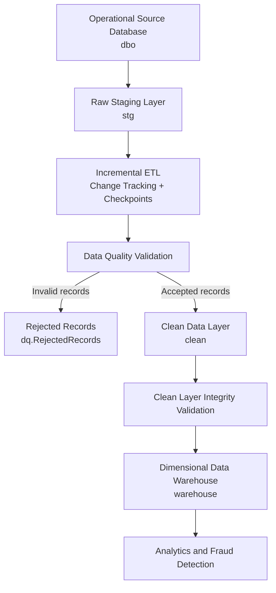

 <div align="center">

# FinFlow

### End-to-End Financial Transaction Data Engineering Platform

A SQL-first financial data pipeline built with **Microsoft SQL Server** and **T-SQL**.


[Architecture](documentation/architecture.md) · [Schema Reference](documentation/schema.md) · [Performance Analysis](documentation/performance_results.md)

</div>

---

## Overview

**FinFlow** is an end-to-end financial transaction data engineering platform that simulates a banking environment and implements a SQL Server data pipeline from operational source systems to an analytical data warehouse.

The project focuses on building a reliable data pipeline through:

- Relational database design
- Data ingestion and staging
- Incremental ETL using SQL Server Change Tracking
- Data quality validation and rejected-record quarantine
- Data transformation and standardization
- Dimensional data warehousing
- Slowly Changing Dimensions (SCD Type 2)
- Advanced SQL analytics and fraud detection
- Query performance analysis and optimization

The project is intentionally **SQL-first**. Its primary implementation uses T-SQL queries, stored procedures, constraints, indexes and database-level orchestration.

## At a glance

| Area | Implementation |
|---|---|
| Database | Microsoft SQL Server Express |
| Development environment | Visual Studio Code |
| Query language | T-SQL |
| Database connectivity | Microsoft SQL Server (`mssql`) extension |
| Source entities | 6 operational tables |
| Incremental processing | SQL Server Change Tracking |
| Data quality | Validation procedures and record quarantine |
| Data warehouse | Dimension and fact tables |
| Historical tracking | SCD Type 2 |
| Orchestration | Stored-procedure-based pipeline |
| Analytics | Customer, transaction, channel, branch and fraud analysis |

---

## Architecture



### Processing layers

1. **Source (`dbo`)** — operational customer, branch, merchant, account, transaction and transaction-entry tables, protected by primary keys, foreign keys, unique constraints and business-rule checks.

2. **Staging (`stg`)** — raw landing tables that retain incoming values as text before type conversion and validation.

3. **Incremental ETL** — SQL Server Change Tracking identifies inserted, updated and deleted source records. Each table maintains an independent synchronization checkpoint in `dbo.ETL_SyncState`.

4. **Data Quality (`dq`)** — validation procedures identify invalid records and preserve their original JSON payloads, rejection reasons and resolution status in `dq.RejectedRecords`.

5. **Clean (`clean`)** — standardized and typed data, refreshed transactionally and validated for duplicate identifiers, missing relationships and ledger inconsistencies.

6. **Warehouse (`warehouse`)** — dimensional tables and two fact tables, with customer history managed through SCD Type 2.

7. **Analytics** — SQL queries and stored procedures for customer analysis, transaction trends, branch performance and rule-based suspicious-activity detection.

---

## Core Engineering Features

### 1. Relational Database Design

- Six operational entities with primary-key and foreign-key relationships.
- Unique constraints for account numbers, transaction references, customer references and other business identifiers.
- CHECK constraints for valid account types, account statuses, transaction statuses and transaction channels.
- Positive-value constraints for transaction and ledger amounts.
- Decimal precision for financial data.
- Timestamp-aware columns for transaction events.

### 2. Incremental ETL and Change Tracking

- Raw staging tables for all six operational entities.
- Independent synchronization checkpoints.
- SQL Server Change Tracking integration.
- INSERT, UPDATE and DELETE propagation.
- Incremental synchronization procedures for all six entities.
- Checkpoint management and error handling.
- Master incremental ETL orchestration.

### 3. Data Quality Management

- Dedicated validation procedures for all six staging entities.
- Invalid identifier detection.
- Missing attribute detection.
- Duplicate business-reference detection.
- Invalid amount, status and date detection.
- Referential-integrity checks.
- Rejected-record quarantine.
- Original record preservation in JSON format.
- Centralized data quality reporting.
- Execution and resolution status tracking.

### 4. Clean Data Layer

- Conversion of raw text values into strongly typed columns.
- Text trimming and standardization.
- Numeric and date validation.
- Referential-integrity validation.
- Transactional clean-layer refresh.
- Duplicate-key checks.
- Financial ledger consistency checks.
- Validation gate before warehouse loading.

### 5. Dimensional Data Warehouse

**Dimension Tables**

| Dimension | Purpose |
|---|---|
| DimDate | Date-based analysis |
| DimCustomer | Customer attributes and history |
| DimBranch | Branch attributes |
| DimMerchant | Merchant information |
| DimAccount | Account attributes |
| DimTransactionType | Transaction classification |
| DimTransactionStatus | Transaction status classification |
| DimChannel | Transaction channel classification |

**Fact Tables**

| Fact Table | Grain |
|---|---|
| FactTransactions | One row per financial transaction |
| FactLedgerEntries | One row per individual debit or credit entry |

Additional warehouse concepts:

- Star-schema-oriented dimensional modelling.
- Surrogate dimension keys.
- Date-key mapping.
- Customer historical version tracking.
- Incremental fact loading.
- Duplicate prevention.

### 6. Slowly Changing Dimensions — Type 2

Customer history is maintained using SCD Type 2.

The implementation preserves historical versions through:

- Surrogate customer keys.
- Version numbers.
- Effective start timestamps.
- Effective end timestamps.
- Current-version indicators.

This allows historical transaction facts to retain their association with the customer dimension version applicable to their reporting period.

### 7. Advanced SQL Analytics

- Customer transaction summaries.
- Account transaction history.
- Transaction channel performance.
- Monthly transaction trends.
- Branch-level transaction analysis.
- Rule-based suspicious transaction detection.
- Reusable stored procedures.
- Window functions and aggregation.
- Correlated transaction-frequency analysis.

### 8. SQL Performance Optimization

- Nonclustered indexes.
- Composite indexes.
- Included index columns.
- SARGable date-range filtering.
- Actual execution-plan inspection.
- Logical read analysis.
- CPU and elapsed-time measurements.
- Index usage and fragmentation inspection.

Performance observations and benchmark limitations are documented in [`documentation/performance_results.md`](documentation/performance_results.md).

---

## Dataset

FinFlow uses entirely synthetic financial data generated through SQL scripts.

### Initial seed dataset

| Entity | Records |
|---|---:|
| Branches | 8 |
| Customers | 30 |
| Merchants | 20 |
| Accounts | 40 |
| Transactions | 300 |
| Transaction Entries | 600 |

Additional synthetic records were created during incremental ETL, Change Tracking and data quality testing.

For example, `BR009` was added as a development test branch. Consequently, the latest verified development snapshot contains nine branches.

### Latest verified warehouse snapshot

| Warehouse Object | Records |
|---|---:|
| DimCustomer | 32 versions |
| DimBranch | 9 |
| DimMerchant | 20 |
| DimAccount | 40 |
| FactTransactions | 300 |
| FactLedgerEntries | 600 |

The customer dimension contains 30 unique customers, 30 current versions and 2 historical versions.

These counts represent the development database snapshot, not production banking data.

---

## Repository Structure

```text
FinFlow/
│
├── README.md
├── .gitignore
│
├── analytics/
│   ├── 01_customer_analysis.sql
│   ├── 02_stored_procedures.sql
│   ├── 02_transaction_analysis.sql
│   └── 03_fraud_detection.sql
│
├── data/
│   └── dataset_sources.md
│
├── database/
│   ├── 01_create_database.sql
│   ├── 02_create_tables.sql
│   ├── 03_constraints.sql
│   ├── 04_indexes.sql
│   ├── 05_inspect_schema.sql
│   ├── 06_inspect_constraints.sql
│   ├── 07_inspect_unique_constraints.sql
│   ├── 08_inspect_foreign_keys.sql
│   └── 09_check_record_counts.sql
│
├── documentation/
│   ├── architecture.md
│   ├── performance_results.md
│   └── schema.md
│
├── etl/
│   ├── 01_validation.sql
│   ├── 02_cleaning.sql
│   ├── 03_transformation.sql
│   ├── 04_incremental_loading.sql
│   ├── 05_change_tracking.sql
│   ├── 06_incremental_etl_procedure.sql
│   ├── 08_master_etl_orchestrator.sql
│   ├── 09_source_stage_reconciliation.sql
│   ├── 10_data_quality_framework.sql
│   ├── 12_customer_quality_rules.sql
│   ├── 13_account_quality_rules.sql
│   ├── 15_transaction_quality_rules.sql
│   ├── 17_transaction_entry_quality_rules.sql
│   ├── 19_branch_quality_rules.sql
│   ├── 21_merchant_quality_rules.sql
│   ├── 23_data_quality_monitoring.sql
│   ├── 24_data_quality_orchestrator.sql
│   ├── 25_staging_pipeline_orchestrator.sql
│   ├── 27_clean_layer_refresh.sql
│   ├── 28_clean_layer_validation.sql
│   ├── 29_clean_layer_validation_procedure.sql
│   └── 30_finflow_master_pipeline.sql
│
├── ingestion/
│   ├── 01_generate_financial_data.sql
│   ├── 01_staging_tables.sql
│   └── 02_data_loading.sql
│
├── optimization/
│   ├── 01_indexes.sql
│   ├── 01_query_performance.sql
│   └── 02_query_optimization.sql
│
└── warehouse/
    ├── 01_dimensions.sql
    ├── 02_fact_tables.sql
    ├── 03_scd_type_2.sql
    ├── 04_inspect_warehouse.sql
    └── 05_warehouse_refresh_procedure.sql
```

*The tree highlights the primary implementation files. Additional test and inspection scripts are present in the repository.*

---

## Setup and Execution

### Prerequisites

- Microsoft SQL Server Express.
- Visual Studio Code.
- Microsoft SQL Server (`mssql`) extension.
- SQL Server permissions to create databases, schemas, tables, indexes and stored procedures, and enable Change Tracking.

### Build sequence

Execute scripts in the following sequence on a fresh SQL Server environment.

**1. Database and source schema**

```text
database/01_create_database.sql
database/02_create_tables.sql
database/03_constraints.sql
database/04_indexes.sql
```

**2. Staging and initial data**

```text
ingestion/01_staging_tables.sql
ingestion/01_generate_financial_data.sql
ingestion/02_data_loading.sql
```

**3. Initial clean layer and schema setup**

Execute:

```text
etl/02_cleaning.sql
```

Before creating stored procedures in the `etl` schema, ensure that the database schema exists:

```sql
USE FinFlowDB;
GO

IF SCHEMA_ID('etl') IS NULL
    EXEC('CREATE SCHEMA etl');
GO
```

**4. Incremental ETL and Change Tracking**

```text
etl/05_change_tracking.sql
etl/06_incremental_etl_procedure.sql
etl/08_master_etl_orchestrator.sql
etl/09_source_stage_reconciliation.sql
```

**5. Data quality framework**

```text
etl/10_data_quality_framework.sql
etl/12_customer_quality_rules.sql
etl/13_account_quality_rules.sql
etl/15_transaction_quality_rules.sql
etl/17_transaction_entry_quality_rules.sql
etl/19_branch_quality_rules.sql
etl/21_merchant_quality_rules.sql
etl/23_data_quality_monitoring.sql
etl/24_data_quality_orchestrator.sql
etl/25_staging_pipeline_orchestrator.sql
```

**6. Warehouse objects**

```text
warehouse/01_dimensions.sql
warehouse/02_fact_tables.sql
warehouse/03_scd_type_2.sql
warehouse/05_warehouse_refresh_procedure.sql
```

**7. Clean-layer refresh and validation**

```text
etl/27_clean_layer_refresh.sql
etl/28_clean_layer_validation.sql
etl/29_clean_layer_validation_procedure.sql
```

**8. Master pipeline**

```text
etl/30_finflow_master_pipeline.sql
```

### Bootstrap note

`etl/06_incremental_etl_procedure.sql` creates the synchronization state table and contains a Change Tracking smoke test that inserts a sample customer.

Run the script only once on a fresh database. To restore the original 30-customer seed baseline after that smoke test, use:

```sql
DELETE FROM dbo.customers
WHERE customer_ref = 'CUST_CT_001';
GO

EXEC dbo.usp_SyncCustomers;
GO
```

### Execute the complete pipeline

Once the database objects and initial data are configured, run:

```sql
USE FinFlowDB;
GO

EXEC dbo.usp_RunFinFlowPipeline;
GO
```

The master procedure coordinates:

1. Incremental source-to-staging ETL.
2. Data quality validation and quarantine.
3. Clean-layer refresh.
4. Clean-layer integrity validation.
5. Data warehouse refresh.
6. Execution and error logging.

Each major stage maintains its own transaction boundaries and execution history. The complete workflow is not one global atomic transaction.

### Development test scripts

Files prefixed with `*_test_*` and `etl/31_test_end_to_end_new_transaction.sql` are optional development tests.

Some deliberately insert invalid staging records or modify synthetic source data to demonstrate Change Tracking, quarantine and incremental processing.

**Do not run test scripts as part of the initial baseline setup.** Review their contents before execution and use a disposable development database when testing destructive or data-modifying scenarios.

---

## Performance Analysis and Limitations

The benchmark dataset contains 300 transactions and 600 ledger entries. These measurements should not be interpreted as production-scale performance benchmarks.

Recorded experiments include:

- Account transaction history retrieval.
- Composite index evaluation.
- Index Seek and Nested Loops execution-plan analysis.
- SARGable versus non-SARGable date filtering.
- Logical read measurements.
- CPU and elapsed-time observations.

In the account-history experiment, the query returned 15 rows and used 34 logical reads both before and after indexing. Although the execution plan showed index seeks, the available measurements do not establish a reliable logical-read improvement.

The date-range query returned the same 85 rows as the `CAST(occurred_at AS DATE)` query, but complete before-and-after performance statistics were not retained.

The project documents these limitations instead of claiming unsupported optimization percentages.

## Documentation

- [System Architecture](documentation/architecture.md)
- [Database Schema Reference](documentation/schema.md)
- [Performance Analysis](documentation/performance_results.md)
- [Dataset Provenance](data/dataset_sources.md)

## Disclaimer

FinFlow is an educational data engineering and portfolio project.

All financial and customer information is synthetic. The project is not designed, certified or suitable for processing real banking transactions, real customer records or personal financial information.

---

## Author

**Nihal Agarwal**

B.Tech — Computer Science and Business Systems  
GITAM University, Hyderabad

**Project:** FinFlow — End-to-End Financial Transaction Data Engineering Platform