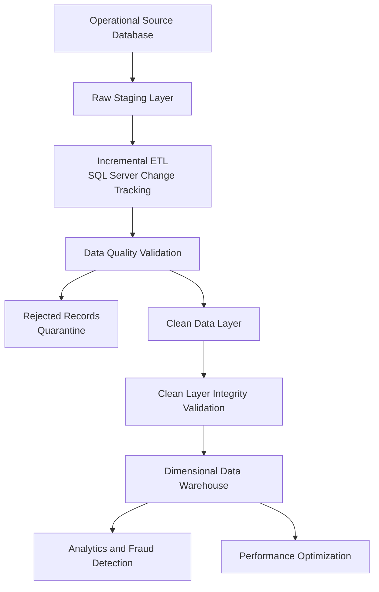
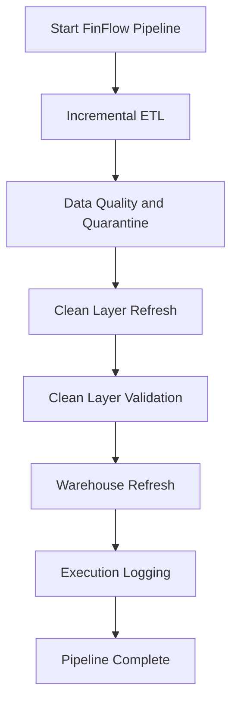

# FinFlow — System Architecture

## 1. Overview

FinFlow is an end-to-end financial transaction data engineering platform built using Microsoft SQL Server and T-SQL.

The architecture follows a layered data processing approach:

1. Operational Source Database
2. Raw Staging Layer
3. Incremental ETL Layer
4. Data Quality and Quarantine Layer
5. Clean Data Layer
6. Dimensional Data Warehouse
7. Analytics and Reporting Layer

---

## 2. High-Level Architecture

---

## 3. Operational Source Layer

The source database contains six operational entities.

| Table | Responsibility |
|---|---|
| dbo.branches | Banking branch information |
| dbo.customers | Customer master information |
| dbo.merchants | Merchant master information |
| dbo.accounts | Customer account information |
| dbo.transactions | Financial transaction records |
| dbo.transaction_entries | Debit and credit ledger entries |

The source layer uses primary keys, unique constraints, foreign keys and CHECK constraints to enforce database-level integrity.

---

## 4. Staging Layer

Schema: `stg`

The staging layer stores incoming records using NVARCHAR-based columns.

Its purpose is to:
- Receive raw source data.
- Preserve incoming values before conversion.
- Support incremental synchronization.
- Provide a landing area for validation and transformation.

The six staging tables correspond to the six operational source tables.

---

## 5. Incremental ETL Layer

The incremental ETL process uses SQL Server Change Tracking.

Each source table has an independent synchronization checkpoint stored in:

`dbo.ETL_SyncState`

The synchronization procedures support:

- INSERT detection.
- UPDATE detection.
- DELETE detection.
- Checkpoint management.
- Error handling and transaction management.

The master incremental ETL procedure coordinates all six synchronization procedures.

---

## 6. Data Quality and Quarantine Layer

Schema: `dq`

Invalid records are identified through SQL-based validation procedures.

The quarantine table is:

`dq.RejectedRecords`

Each rejected record captures:

- Source table.
- Source record identifier.
- Rejection reason.
- Original record payload in JSON.
- Detection timestamp.
- Resolution status.

Separate validation procedures cover branches, customers, merchants, accounts, transactions and transaction entries.

A centralized data quality report summarizes rejection counts and unresolved records.

---

## 7. Clean Data Layer

Schema: `clean`

The clean layer converts raw staging values into strongly typed data.

Key operations include:

- Numeric and date conversion.
- TRIM and NULLIF.
- Case standardization.
- Invalid-value filtering.
- Referential integrity checks.

The clean-layer refresh procedure rebuilds the six clean tables within a transaction.

A separate integrity validation procedure checks duplicate identifiers, missing relationships and financial ledger consistency.

---

## 8. Data Warehouse

Schema: `warehouse`

The warehouse follows a dimensional modelling approach.

### Dimension Tables

| Dimension | Purpose |
|---|---|
| DimDate | Date-based analysis |
| DimCustomer | Customer attributes and history |
| DimBranch | Branch attributes |
| DimMerchant | Merchant attributes |
| DimAccount | Account attributes |
| DimTransactionType | Transaction classification |
| DimTransactionStatus | Transaction status |
| DimChannel | Transaction channel |

### Fact Tables

| Fact table | Grain |
|---|---|
| FactTransactions | One row per financial transaction |
| FactLedgerEntries | One row per debit or credit entry |

### Slowly Changing Dimension Type 2

Customer history is maintained through SCD Type 2.

Historical versions are preserved using:

- Surrogate customer keys.
- Version numbers.
- Effective start dates.
- Effective end dates.
- Current-version indicators.

This allows historical transactions to retain their relationship with the customer attributes applicable to their reporting period.

---

## 9. Analytics Layer

The analytics layer contains reusable SQL queries and stored procedures for:

- Customer transaction analysis.
- Transaction channel performance.
- Monthly transaction trends.
- Branch performance.
- Suspicious transaction identification.
- Account transaction history and summaries.

Fraud detection uses configurable SQL rules based on transaction amounts and transaction frequency.

---

## 10. Performance Optimization

The optimization layer demonstrates:

- Nonclustered indexes.
- Composite indexes.
- Included index columns.
- SARGable filtering.
- Execution-plan inspection.
- Logical reads and execution-time comparisons.

Performance measurements are documented separately in:

`documentation/performance_results.md`

---

## 11. End-to-End Orchestration

The main execution procedure is:

`dbo.usp_RunFinFlowPipeline`

Its workflow is:

Each major stage maintains its own execution and error logs.

The pipeline stops when a stage fails. Previously committed stages are not automatically rolled back as one global transaction.

---

## 12. Dataset

The development dataset uses synthetic financial data.

| Entity | Records |
|---|---:|
| Branches | 9 |
| Customers | 30 |
| Merchants | 20 |
| Accounts | 40 |
| Transactions | 300 |
| Transaction Entries | 600 |

Customer dimension versions may exceed the number of unique customers due to historical SCD Type 2 records.

---

## 13. Technology Stack

- Microsoft SQL Server Express
- T-SQL
- SQL Server Change Tracking
- Visual Studio Code
- Microsoft SQL Server VS Code Extension

---

## 14. Design Considerations

FinFlow is an educational data engineering platform.

The data is synthetic and the implementation is not intended for production banking operations.

The project demonstrates data ingestion, transformation, integrity enforcement, incremental processing, dimensional modelling and analytical SQL.
