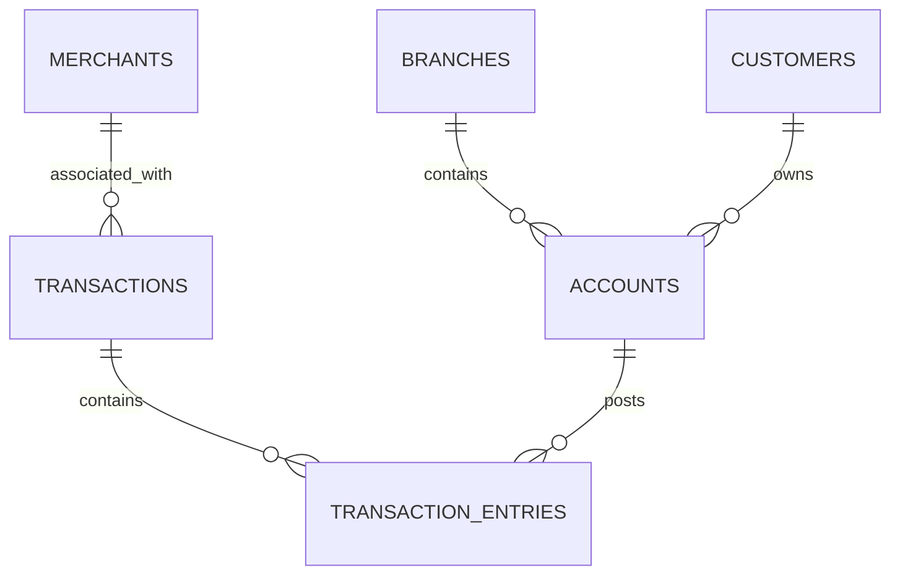

# FinFlow — Database Schema Reference

## 1. Operational Database

Database: `FinFlowDB`

Schema: `dbo`

The operational layer contains six relational tables.

### Branches

Purpose: Stores banking branch information.

| Column | Data type | Description |
|---|---|---|
| branch_id | INT | Primary key |
| branch_code | VARCHAR(20) | Unique branch identifier |
| branch_name | VARCHAR(100) | Branch name |
| city | VARCHAR(80) | Branch city |
| state | VARCHAR(80) | State |
| created_at | DATETIME2 | Creation timestamp |

### Customers

Purpose: Stores customer master information.

| Column | Data type | Description |
|---|---|---|
| customer_id | BIGINT | Primary key |
| customer_ref | VARCHAR(30) | Unique customer reference |
| first_name | VARCHAR(60) | First name |
| last_name | VARCHAR(60) | Last name |
| email | VARCHAR(150) | Unique email |
| phone | VARCHAR(20) | Unique phone number |
| date_of_birth | DATE | Date of birth |
| customer_status | VARCHAR(15) | Customer status |
| created_at | DATETIME2 | Creation timestamp |

### Merchants

Purpose: Stores merchant information.

| Column | Data type | Description |
|---|---|---|
| merchant_id | INT | Primary key |
| merchant_code | VARCHAR(30) | Unique merchant identifier |
| merchant_name | VARCHAR(120) | Merchant name |
| merchant_category | VARCHAR(50) | Merchant category |
| city | VARCHAR(80) | City |
| country | VARCHAR(80) | Country |
| created_at | DATETIME2 | Creation timestamp |

### Accounts

Purpose: Stores customer bank account information.

| Column | Data type | Description |
|---|---|---|
| account_id | BIGINT | Primary key |
| account_number | VARCHAR(30) | Unique account number |
| customer_id | BIGINT | Customer foreign key |
| branch_id | INT | Branch foreign key |
| account_type | VARCHAR(20) | Account classification |
| account_status | VARCHAR(15) | Account status |
| currency_code | CHAR(3) | Currency |
| current_balance | DECIMAL(19,4) | Current balance |
| opened_at | DATETIME2 | Account opening timestamp |
| modified_at | DATETIME2 | Last modification timestamp |
| row_version | ROWVERSION | Row version |

### Transactions

Purpose: Stores financial transaction headers.

| Column | Data type | Description |
|---|---|---|
| transaction_id | BIGINT | Primary key |
| transaction_ref | VARCHAR(40) | Unique transaction reference |
| merchant_id | INT | Optional merchant foreign key |
| transaction_type | VARCHAR(20) | Transaction type |
| transaction_status | VARCHAR(15) | Transaction status |
| transaction_amount | DECIMAL(19,4) | Transaction amount |
| currency_code | CHAR(3) | Currency |
| transaction_channel | VARCHAR(20) | Transaction channel |
| occurred_at | DATETIME2 | Transaction timestamp |
| created_at | DATETIME2 | Record creation timestamp |

### Transaction Entries

Purpose: Stores individual debit and credit ledger entries.

| Column | Data type | Description |
|---|---|---|
| entry_id | BIGINT | Primary key |
| transaction_id | BIGINT | Transaction foreign key |
| account_id | BIGINT | Account foreign key |
| entry_type | VARCHAR(10) | DEBIT or CREDIT |
| entry_amount | DECIMAL(19,4) | Ledger amount |
| entry_timestamp | DATETIME2 | Entry timestamp |

---

## 2. Database Relationships

## 3. Staging Layer

Schema: `stg`

Tables:

- Branches
- Customers
- Merchants
- Accounts
- Transactions
- TransactionEntries

Staging tables use NVARCHAR columns for raw data landing and subsequent type conversion.

## 4. Clean Layer

Schema: `clean`

Tables:

- Branches
- Customers
- Merchants
- Accounts
- Transactions
- TransactionEntries

The clean layer stores converted and standardized data.

## 5. Data Quality Layer

Schema: `dq`

Primary table:

`dq.RejectedRecords`

Stores invalid records, rejection reasons, original JSON payloads and resolution status.

## 6. Warehouse Layer

Schema: `warehouse`

### Dimensions

- DimDate
- DimCustomer
- DimBranch
- DimMerchant
- DimAccount
- DimTransactionType
- DimTransactionStatus
- DimChannel

### Facts

**FactTransactions**

Grain: One row per financial transaction.

**FactLedgerEntries**

Grain: One row per individual debit or credit entry.

### Historical Tracking

DimCustomer implements Slowly Changing Dimension Type 2 using:

- customer_key
- version_number
- is_current
- effective_from
- effective_to

## 7. Data Model Principles

- Operational tables use primary and foreign keys.
- Unique constraints protect important business identifiers.
- CHECK constraints enforce valid transaction and account values.
- Warehouse dimensions use surrogate keys.
- Fact tables reference dimension keys.
- Ledger entries preserve the debit/credit transaction grain.
